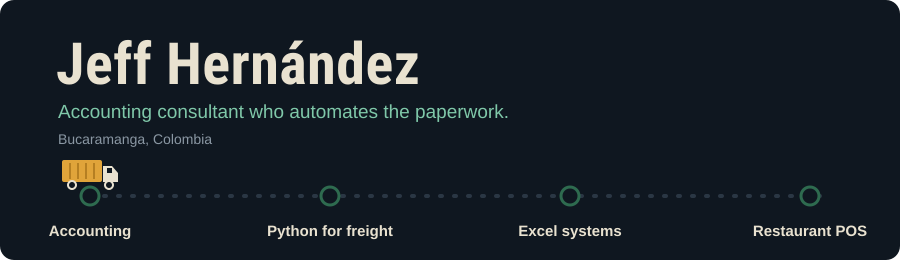

<!--
  ESTILO: Dinámico con animación ("ruta de carga")
  INSPIRACIÓN: DenverCoder1 (github.com/DenverCoder1/DenverCoder1, "Dynamic Realtime 💫") por el texto que se escribe,
  y Marton Lederer / Livio Brunner (github.com/martonlederer/martonlederer, github.com/BrunnerLivio/BrunnerLivio)
  por usar imágenes SVG propias guardadas en el repo en lugar de banners genéricos.
  Lección tomada: un solo momento animado y memorable vale más que muchos efectos sueltos.
  La animación principal es assets/ruta-carga.svg (propia, sin servicios externos).
-->

  

  

### What's on the route

**Accounting.** Bookkeeping, financial reporting and advice for Colombian companies.

**Python for freight.** Scripts that move data between freight operations and TMS platforms so nobody retypes it.

**Excel systems.** Payroll and time-tracking workbooks built for teams that live in Excel.

**Restaurant POS.** Customers scan a QR, order from their phone and pay their own share. In development.

> 🇨🇴 Hablo español e inglés. Si tu empresa repite el mismo proceso cada semana, escríbeme.

  
   
  
  <!-- [COMPLETAR] otras herramientas exactas -->

  
  

