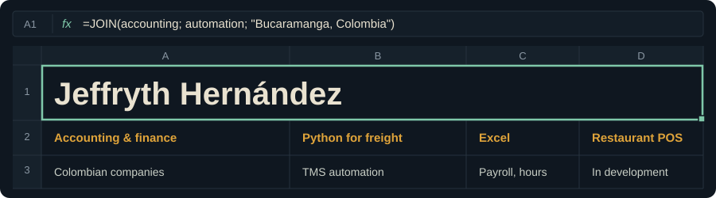

<!--
  ESTILO: Corporativo / portafolio ("hoja de cálculo")
  INSPIRACIÓN: Martin Heinz (github.com/MartinHeinz/MartinHeinz, "A Little Bit of Everything 😃") por la estructura de portafolio,
  y Livio Brunner (github.com/BrunnerLivio/BrunnerLivio, "Retro 😎") por el encabezado como imagen propia del repo.
  Lección tomada: para quien contrata, una tabla de servicios clara vale más que cualquier widget.
  El encabezado es assets/hoja-calculo.svg (propio): tu perfil como una hoja de Excel, el lugar donde trabajan tus clientes.
-->

 

I help Colombian companies keep their numbers in order and stop doing the same work twice.
*Ayudo a empresas colombianas a tener sus cuentas claras y a dejar de hacer dos veces el mismo trabajo.*

### Services

| Service | For | You get |
|---|---|---|
| **Accounting & financial consulting** | Colombian small and mid-size companies | Up-to-date books, financial reports and advice you can act on |
| **Freight and TMS automation** | Logistics and freight teams | Python scripts that move data between your operation and your TMS, without retyping |
| **Excel business systems** | Teams that run on spreadsheets | Payroll and time-tracking workbooks with clear formulas and checks |
| **Restaurant technology** | Restaurants | A POS where customers order by QR and pay their own share (in development) |

### Selected work

<b>Restaurant POS and QR ordering</b> &nbsp;Next.js, TypeScript, Supabase, PostgreSQL

 
Customers scan the QR on their table, order from their phone and pay exactly their part. The kitchen sees each order in real time.
Each restaurant's data is isolated at the database level. Private repository; demo on request.

<b>Freight and TMS automations</b> &nbsp;Python

 
[COMPLETAR: qué proceso automatiza, cuánto tiempo ahorra y enlace si es público]

<b>Payroll and time-tracking systems</b> &nbsp;Excel

 
[COMPLETAR: para qué tipo de empresa, qué calcula y enlace o captura]

### Tools

&nbsp;

<!-- [COMPLETAR] otras herramientas exactas -->

### Work with me

